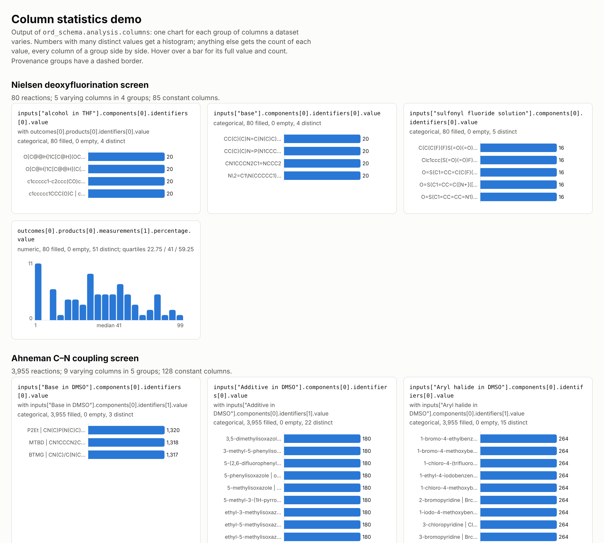

# Column statistics demo

[`column_statistics.html`](column_statistics.html) shows what
[`ord_schema.analysis.columns`](../../../ord_schema/analysis/columns.py) produces for
three example screens: one chart for each group of columns a dataset varies. Numbers
with many distinct values get a histogram; anything else gets the count of each value,
with every column of a group, such as a compound's name and SMILES, side by side.



Download the HTML file and open it in a browser. It is self-contained: the charts are
inline SVG, so it needs no network access, and it follows the browser's light or dark
theme. Hover over a bar for its full value and count.

## The datasets

| Section | Source |
| --- | --- |
| Nielsen deoxyfluorination screen | [`nielsen_fig1_dataset.pbtxt`](../../submissions/2_Nielsen_Deoxyfluorination_Screen/nielsen_fig1_dataset.pbtxt), in this repository |
| Ahneman C–N coupling screen | built by [`example_Ahenman.ipynb`](../../submissions/9_Ahneman_Science_CN_Coupling/example_Ahenman.ipynb) |
| Santanilla nanomole HTE | built by [`example_Santanilla.ipynb`](../../submissions/1_Santanilla_Nanomole_HTE/example_Santanilla.ipynb) |

The two notebooks build their datasets in memory without saving them. To save them,
run each notebook with one more cell at the end:

```python
# example_Ahenman.ipynb builds a list of reactions.
from ord_schema import message_helpers
from ord_schema.proto import dataset_pb2

message_helpers.save_message(dataset_pb2.Dataset(reactions=reactions), "ahneman.pb.gz")
```

```python
# example_Santanilla.ipynb builds a Dataset.
from ord_schema import message_helpers

message_helpers.save_message(dataset, "santanilla.pb.gz")
```

## Rebuilding the page

From the repository root, with the datasets saved as above:

```bash
uv run python examples/demo/column_statistics/make_demo.py \
    --output examples/demo/column_statistics/column_statistics.html \
    "Nielsen deoxyfluorination screen=examples/submissions/2_Nielsen_Deoxyfluorination_Screen/nielsen_fig1_dataset.pbtxt" \
    "Ahneman C–N coupling screen=ahneman.pb.gz" \
    "Santanilla nanomole HTE=santanilla.pb.gz"
```

Each argument is a dataset path, optionally with a display name before an equals
sign. The script takes any dataset ORD can read (`.pb.gz`, `.pbtxt`, `.parquet`), so
it also works as a quick look at a dataset of your own.

The screenshot was taken in Chromium at a 1280px-wide viewport and 2× scale.
