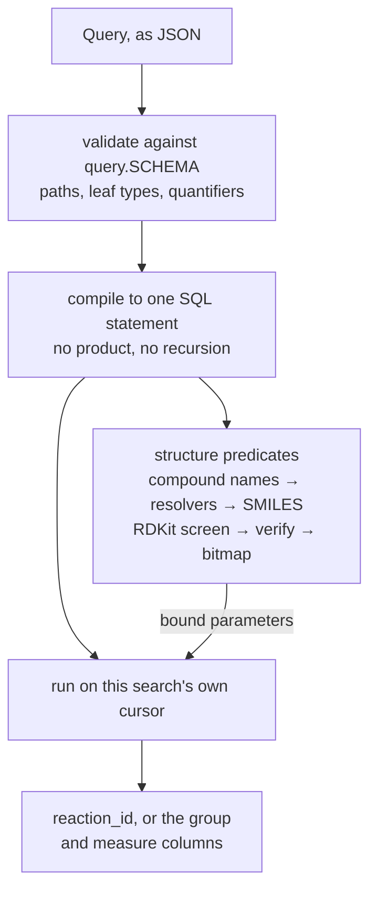
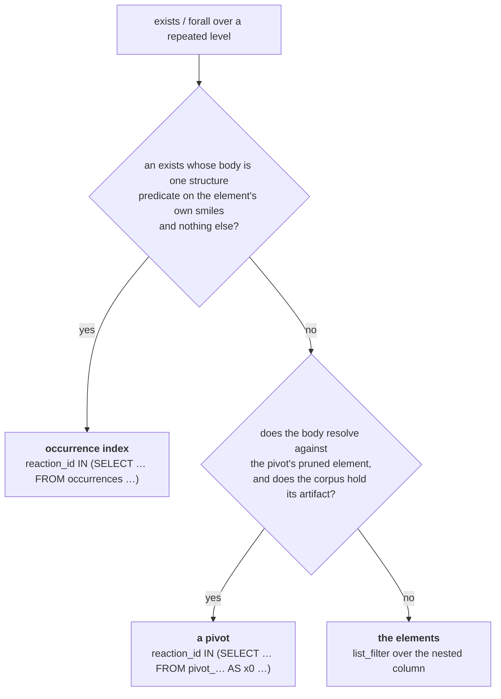

# Searching ORD

The serialized protocol buffers in [ord-data](https://github.com/open-reaction-database/ord-data)
are the [source of truth](https://en.wikipedia.org/wiki/Single_source_of_truth), and the
[projection](../artifacts/projection.py) restates them as nested Parquet so a query engine can read one
leaf without deserializing the rest. This package is how a language model reaches that
projection: what the model is told it may query, what it is allowed to emit, and how that
becomes SQL.

Requires the `search` extra (`pip install "ord-schema[search]"`).

## Why the model does not write SQL

The obvious design is to let the model write DuckDB SQL and check it. That was tried, and the
check cannot be made to hold: **the expensive programs expressible in SQL cannot be
enumerated.** A validator that refuses `UNNEST` in a `FROM` clause still accepts a self-join
over 2.4M reactions, a cross join against `range`, a recursive CTE counting to a billion, and a
predicate-free `SELECT *`. Entries can be added to that blacklist, but it never finishes.

So the model emits a `Query` instead, and the library compiles it. The grammar has one
relation, no join, no recursion, and no set-returning function, which means the worst program
expressible in it is **one pass over the corpus plus a sort**. Expensive queries are not
discouraged; they are unwritable. Where the compiler reads another relation — a pivot, the
occurrence index, the first commits — it is a semi-join or a one-to-one join on
`reaction_id`, or the first commits read in place of the projection, never a product.

The same move settles two other things SQL leaves to whoever writes it:

- **Quantifiers are stated, never assumed.** A path crossing a repeated level is refused unless
  an `exists` or `forall` binds it. The equivalent SQL is `UNNEST`, which silently means "any"
  *and* multiplies the row count.
- **Repeated levels compile to list lambdas**, never to `UNNEST` in a `FROM` clause — measured
  at 27–200× the cost for identical answers, and the idiom every SQL tutorial teaches. A
  compiler cannot reach for the wrong one.

It gives up nothing in reach. A column is a *parameter* rather than part of the grammar, so all
442 leaves of the projection are queryable, and a field added upstream becomes queryable at no
cost here.

## The grammar

```text
Query      = { where?: Predicate, aggregate?: Aggregate,
               order_by?: [Order], limit?: int }

Predicate  = { op: "and" | "or", clauses: [Predicate] }
           | { op: "not", clause: Predicate }
           | { op: "exists" | "forall", path: Path, where: Predicate }
           | { op: "eq"|"ne"|"lt"|"le"|"gt"|"ge", path: Path, value: Value }
           | { op: "contains"|"starts_with"|"ends_with", path: Path, value: Value }
           | { op: "is_null" | "not_null", path: Path }
           | { op: "substructure", path: Path, smarts?: string, compound?: <name>,
               chirality?: bool }
           | { op: "similarity", path: Path, smiles?: string, compound?: <name>,
               threshold: float }
           | { op: "same_compound", path: Path, smiles?: string, compound?: <name> }
           | { op: "same_parent", path: Path, smiles?: string, compound?: <name> }
           | { op: "reaction_smarts", smarts: string, chirality?: bool }

Value      = { literal: <scalar> }

Aggregate  = { over?: Path, where?: Predicate, group_by: [Path],
               measures: [{ fn: "count"|"count_distinct"|"sum"|"avg"|"min"|"max",
                            path?: Path | Reduction, name: string }] }

Reduction  = { reduce: "min"|"max"|"avg"|"sum"|"count", path: Path, where?: Predicate }

Order      = { key: string | Reduction, descending?: bool }
```

A `Path` is a dotted column path such as `conditions.temperature.setpoint_kelvin`. Inside an
`exists` or `forall` it is **relative to the bound element**, which is what lets one component
be required to satisfy several conditions at once.

A key the grammar does not name is refused rather than dropped. Every field that narrows a
query is optional, so an ignored key would leave a query missing the clause it was meant to
carry — and a `Query` with no `where` is every reaction in the corpus, returned as an answer
rather than as a failure.

Every rule below is enforced against `projection.SCHEMA` before any SQL exists, so a bad query
is a compile error rather than a wrong answer:

- A comparison path must end at a scalar and must not cross a repeated level.
- An `exists`/`forall` path must end *at* a repeated level.
- A path naming an artifact-internal column (`structure_id`, the join key into the
  structures artifact) is refused, and internal columns are withheld from the rendered
  schema and from "did you mean" suggestions: their values are not stable across
  builds.
- Operators must suit the leaf type — `contains` is text-only, ordering is numeric or
  temporal only.
- `group_by` paths must be scalar, so the number of groups is bounded by the values a column
  holds rather than by an explosion over a repeated level.
- No two output columns of an aggregate share a name: a `group_by` path given twice, two
  measures with one `name`, and a measure named as a `group_by` path are refused. Names
  compare without regard to case, as DuckDB compares identifiers.
- `aggregate.over` names a repeated level and makes the rows its elements rather than
  reactions, which is the only way to group by something a reaction has many of — "the most
  common solvent" is not a column of a reaction. Paths inside are relative to the element,
  `aggregate.where` selects the elements grouped and the query's own `where` selects the
  reactions whose elements are counted, and `count_distinct` over `reaction_id` is what
  answers about reactions rather than occurrences. One level, never nested, so the rows are
  that level's own cardinality and the query stays one pass and a sort. It reads the pivot
  artifact for the level and is refused without one: reaching the elements otherwise means
  the `UNNEST` this grammar exists to make unwritable.
- A `Reduction` is the one place a repeated path is read without a quantifier: it reduces
  that reaction's own elements to a single value, so `max` over `outcomes.products.measurements.percentage.value`
  is the reaction's best yield rather than the corpus's. Its path must cross a repeated level;
  a scalar one is refused, since it would give the same query two spellings. It reads the
  pivot over the deepest level the path crosses where the corpus holds one, and the
  projection's lists otherwise; the answer is the same either way, and the measurement is
  below.
- A `Reduction`'s `where` selects which elements are reduced, with paths relative to the
  element as inside a quantifier. It is what separates "the highest yield" from "the
  highest percentage anything was measured at": 42,909 of the corpus's percentage-valued
  measurements are selectivity, purity, area, or custom, so the bare path answers a
  broader question than the one asked. Quantifying inside it is refused on both routes,
  since the pivot carries an element's non-repeated fields only and whether a filter
  compiles should not depend on which artifacts a corpus holds.
- `count` answers zero for a reaction holding no elements under the path, whichever route
  reads them. The projection spells an absent repeated level NULL rather than empty --
  788,334 reactions record no workups this way -- so the list route coalesces, because
  "how many does this reaction have" is answered by none rather than by unknown. The
  arithmetic reducers yield NULL there, which is what an average over nothing is.
- `avg` and `sum` need a numeric column, whether they reduce a repeated path or aggregate a
  scalar one, and so does a measure reading a reduction: a `sum` over each reaction's `min`
  of a timestamp is refused. `min` and `max` take a date or timestamp column too, and answer
  the earliest or latest day. `count` takes any. Arithmetic over text is refused where
  the query is compiled rather than left to fail where it runs.
- A timestamp compares **by day**. Each one is the wall clock its source wrote, in whatever
  zone it wrote it: `utc_offset_minutes` beside it names that zone only where the record did,
  and sources write in many zones, so comparing them finer than a day would order times that
  were never on one clock. The compiler casts every timestamp to its `DATE` wherever it
  enters the SQL — a comparison, a reduction, a measure, a `group_by`, an ordering — so `eq`
  matches every time on the day and a group is a day; the schema the model sees names these
  columns `DATE`. A literal compared against one is `YYYY-MM-DD` and nothing else. One
  carrying a time, or an offset after it, is refused rather than read as its day, which
  would answer a question about a moment with every reaction that day.
- A structure predicate's `compound` is resolved through
  [`ord_schema.resolvers`](../resolvers.py) when the query runs, so the model names compounds
  and never spells structures. The name goes to the resolver and never reaches the SQL, so it
  is any printable name of up to 500 characters with no whitespace around it: `2-pyridone`
  and `N,N-dimethylformamide` as much as `thf`. The corpus keeps each name's answer for
  later searches, and a name the resolver fails on is asked again next time. A result states
  what each name was searched as under `execute.RESOLVED`, which `execute.resolutions` reads.
- A comparison's value is a literal, never a compound: a resolved name compared with `eq`
  against a `smiles` would compare spellings, which miss the same compound drawn as another
  tautomer or protonation state and need not agree across RDKit releases. A
  `{"compound": ...}` value is refused with a message pointing to `same_compound`.
- A `{"literal": ...}` value is **bound as a parameter**, typed: a string compared against a
  date or timestamp column binds as the day it names. No literal reaches the SQL as text.
  What the model writes that does is the `limit`, validated as a positive integer, measure
  names, held to an identifier shape and quoted so that `order` or `true` is a name rather
  than a keyword, and each `group_by` path, quoted as its column's name once it has resolved
  against the schema.
- A `substructure` respects the stereocenters its pattern draws, as RDKit does: a
  pattern drawn as one enantiomer matches that enantiomer, not its mirror image or the
  same molecule recorded without stereo. `chirality: false` ignores them, for a question
  about the molecule whatever its configuration. The flag is part of the cached match
  set's key, so the two questions never share an answer. CXSMILES stereo groups count
  as well: a structure recorded as a racemate (`&`) or as an unknown single enantiomer
  (`o`) matches a pattern drawn as either enantiomer, and a pattern drawn as a racemate
  matches only racemates.
- A `reaction_smarts` is a condition on the reaction, refused inside a quantifier, and
  every template in it has to match: each reactant template a component whose role is
  `REACTANT`, each product template a product, each agent template a component in any
  other role. Templates on one side match different molecules, so `C(=O)O.N` needs an
  acid and an amine rather than one molecule holding both, even one recorded twice; a
  grouped template, `(C(=O)O.N)`, asks for both pieces in one molecule. It compiles to
  one `exists` per template, which the occurrence index answers for a product template,
  and a count of distinct SMILES per subset of two or more templates on a side, which is
  what holds them to different molecules; a side holds at most five templates, which
  bounds the counts at 26 per side. That is stricter than the RDKit cartridge's `@>`,
  which accepts any one template per side; over a 40,000-reaction sample a Suzuki query
  returns 7,667 reactions through `@>` and 971 this way
  ([logbook](https://github.com/open-reaction-database/ord-logbook/blob/main/entries/2026-10-02-reaction-smarts-without-the-cartridge/README.md)).
  Atom maps are ignored, as `@>` ignores them, and `chirality` applies to every template.
- A `substructure`/`similarity`/`same_compound`/`same_parent` path must name a compound's
  `smiles`, inside a quantifier like any other element predicate.
- `same_compound` asks "the same compound, however either was drawn"; an `eq` on a `smiles`
  asks "the same spelling". Acetic acid and acetate, an amine and its ammonium, a 2-pyridone
  and its 2-hydroxypyridine tautomer are each one reagent written two ways, and each compares
  unequal under `eq`. It matches on the `mol_hash` the structures artifact derives — RDKit's
  registration hash of the uncharged molecule — so protonation state, tautomer, and atom-map
  labels are ignored. Fragments and stereochemistry are not: sodium acetate is still a
  different reagent from acetic acid, and enantiomers are still different compounds. Prefer
  it to `eq` whenever the question names a compound rather than a string.
- `same_parent` is the looser question, and the one to reach for only when a question says
  it does not care which salt: what `same_compound` ignores, plus the counterions a reagent
  was sold as, so sodium acetate matches acetic acid and triethylamine hydrochloride matches
  triethylamine. A bare compound name is `same_compound`. Stripping stops where the molecule *is* the salt —
  what survives must still hold carbon — so sodium hydride does not match hydrogen and
  palladium acetate does not match acetic acid. It is looser on purpose and that is
  sometimes wrong: sodium and potassium carbonate share a parent, which is right for
  "reactions using carbonate" and wrong for a question about the sodium. Ask
  `same_compound` for that one. Only the counterions RDKit recognizes are set aside — the
  halides, Li/Na/K/Ca/Mg, and the usual acid counterions — so a salt of anything else,
  cesium carbonate among them, is left whole and matches only itself.
- A SMARTS naming a hydrogen the corpus stores implicitly is rewritten, with a warning,
  rather than run as written: stored molecules come from SMILES, so `[H]OC` matches no
  methanol and would return empty without saying why. `MergeQueryHs` folds it to
  `[O&!H0]C`, which matches. Hydrogens that cannot be folded — isotopic (`[2H]`), or
  with no heavy atom to fold into (`[H][H]`) — are left exactly as written, because
  those are real graph atoms in a stored molecule and the query already works;
  28,297 ORD reactions have an `[H][H]` component.

## How a query is answered

One `Query` becomes one SQL statement. The chemistry and every literal are lifted out of it
and bound as parameters, so what DuckDB runs is a filter over the projection and nothing
else:



Three relations can answer a quantifier, and the compiler chooses **per quantifier**
rather than per query — so one statement can spend the occurrence index on one clause
and a pivot on the next:



The three answer identically — that is what the differential tests pin — and differ only
in what they read. Worked examples, with the route each clause takes:

| query | clause | route |
| --- | --- | --- |
| above 350 K | `conditions.temperature.setpoint_kelvin > 350` | no quantifier: the projection |
| pyridine among the inputs | `exists inputs.components` | occurrence index |
| pyridine as the solvent | `exists inputs.components` | pivot — the role is an element field, which an occurrence row does not carry |
| pyridine among the inputs, yield above 50% | `exists inputs.components` | occurrence index |
| | `exists outcomes.products.measurements` | pivot |
| solvent-free: no component is a solvent | `forall inputs.components` | pivot — the index shows which elements match, never that all of them do |
| pyridine **and** a boronic acid in one component | `exists inputs.components` | pivot — two structure predicates is one more than an occurrence row can carry |
| a desired product with a yield above 50% | `exists outcomes.products`, nested `exists measurements` | both levels' pivots, joined on the ordinal prefix |
| the ten highest-yielding reactions | `order_by` a `reduce` over `outcomes.products.measurements` | no quantifier: the level's pivot, or the projection's lists without one |

Every pivot row above falls to the elements when the corpus holds no artifact for the
level. The answer does not change; the query gets slower, and the log says which
relations it read.

## First commits

`first_commit` — when a reaction first reached ord-data, which commit, and the dataset
it arrived in — is part of the schema a model reads but not of the projection: it comes
from ord-data's git history rather than the record, and lives in its own
[`first_commits`](../artifacts/first_commits.py) artifact, one row per reaction. The
corpus publishes those as a relation beside the projection, and the compiler reads it
only for a query naming `first_commit`:

| query | compiles to |
| --- | --- |
| anything not naming `first_commit` | exactly what it would without the artifact |
| added to ORD in 2022 | `SELECT reaction_id FROM first_commits WHERE …`, the projection unread |
| how many reactions arrived in each dataset, or the earliest arrival | `FROM first_commits` alone, grouped or measured |
| above 350 K and added in 2022 | `reactions.reaction_id IN (SELECT reaction_id FROM first_commits WHERE …)`, holding both bounds, beside the projection's filter |
| above 350 K or added since 2025 | a semi-join of its own inside the `OR` |
| how many reactions above 350 K arrived in each dataset | `FROM reactions JOIN first_commits USING (reaction_id)`, grouped |
| reactions above 350 K, ordered by arrival | the same join |

A query whose filters, groups, measures, and ordering read nothing but `first_commit` and
`reaction_id` reads the first commits alone. They hold one row for each reaction the
corpus holds, so the answer is the one a join to the reactions would give, from a
relation of two columns rather than the projection. Any other query naming
`first_commit` reads the projection too. Every filter a conjunction places on
`first_commit` then goes into one semi-join, since one per filter makes DuckDB build and
probe a hash table for each. The subquery excludes a NULL `reaction_id`, as a pivot's
does, so a `not` around it never meets the NULL that makes `NOT IN` answer NULL. A join
is reserved for grouping, measuring, and ordering, which need the value on the row; it
would otherwise run for every query, since DuckDB keeps a `LEFT JOIN` whose columns
nothing reads.

A corpus opened without `first_commits_pattern` refuses a query naming `first_commit`.
One opened with it pairs an artifact holding as many rows with every projection, or
refuses: with a dataset missing, a negated filter would answer as though its reactions
matched. It also refuses first commits naming a reaction other than its own, which an
artifact edited after it was written can do with its count and stamps intact, and a first
commit with a field left NULL, which no derivation writes. Read alone, the first commits
would otherwise count a reaction the corpus does not hold, and a `not` over a NULL field
holds through a semi-join but not on a row carrying it. That is one anti-join of the
reactions against the first commits and one scan of the first commits, run beside the
check that the corpus states each reaction once: at open, or with `warm=False` before
the first query reading them. Measured on 2026-10-21 over the 93-dataset corpus in a
container capped at 12 GiB with swap off, it took 0.17–0.18 s, and over five warm opens
each the peak was 4.14–4.15 GiB with it against 4.08–4.15 GiB without, since building
the substructure library sets that peak.

What reading them costs, measured on 2026-10-21 over the 93-dataset corpus with
projections at 10,000 rows per row group, median of 15 warm runs in each of three
processes, DuckDB at 2 threads. As a column is the same projections carrying
`first_commit`, behind the same view and settings; joined is the semi-join or join a
query reading the projection too runs; alone is the first commits alone. Every route
returns the same answer.

| query | as a column | joined | alone |
| --- | --- | --- | --- |
| added in 2022, 1.8M reactions | 0.138 s | 0.235 s | 0.098 s |
| how many reactions arrived in 2022 | 0.115 s | 0.208 s | 0.086 s |
| not added in 2022 | 0.102 s | 0.180 s | 0.073 s |
| how many reactions arrived in each dataset | 0.159 s | 0.256 s | 0.126 s |
| the earliest arrival | 0.042 s | 0.161 s | 0.012 s |
| the first three arrivals of 2022 | 0.076 s | 0.166 s | 0.046 s |

Read alone, a question about arrivals runs 2.0–3.6 times as fast as joined, and 13 times
for the earliest arrival, which reads one column of the artifact rather than joining
every reaction. It also runs 1.3–1.7 times as fast as a column of the projection would,
3.5 times for the earliest arrival. At 8 threads alone runs 2.0–3.5 times as fast as
joined (9.8 for the earliest arrival) and 1.2–1.6 times as fast as a column (2.8). Beyond
what opening the corpus holds, it peaks lower than joined for every query: 2 MiB against
249 MiB for the earliest arrival, and 884 MiB against 1,190 MiB for the filter returning
1.8M reactions.

A query reading the projection too pays for the semi-join or the join, on the same
corpus and settings:

| query | as a column | joined |
| --- | --- | --- |
| above 350 K (does not name it) | 0.108 s | 0.107 s |
| above 350 K and added in 2022 | 0.111 s | 0.144 s |
| above 350 K or added since 2025 | 0.167 s | 0.221 s |

A filter on `first_commit` beside one on the projection takes 1.3 times as long as it
would reading a column, and at 8 threads 0.8–1.0 times. A query not naming
`first_commit` costs what it would without the artifact.

## Structure search

A structure predicate compiles to a bitmap test, not to chemistry. The chemistry runs
in [`execute.Corpus`](execute.py) against the [structures artifact](../artifacts/structures.py).
Substructure runs through an RDKit `SubstructLibrary` built over the corpus: a
fingerprint **screen** — complete but not exact — over every distinct molecule in the
corpus, then exact subgraph **verification** of the survivors. It runs on RDKit's own
threads with the GIL released, so one `Corpus` serves concurrent requests without
forking; the library is built at open, which `Corpus(warm=False)` defers to the first
substructure query, and costs seconds and 2.6–2.9 GiB resident for the full corpus.
Each search takes its own DuckDB cursor, since a connection holds the pending result of
its last `execute` and concurrent searches sharing one would read each other's rows.
`threads` is per search rather than per corpus, so a server expecting several at once
should set it to the core count divided by that concurrency instead of leaving it at
`-1`.

Finding which reactions hold a match is a separate cost from the chemistry, and the
larger one. An **occurrence index** — one row per structure occurrence, carrying the
corpus-wide ID and the path — makes that a semi-join against a narrow relation rather
than a scan of every reaction. It carries nothing of the element, so a structure bound
to one of the element's fields — pyridine *as the solvent* — is answered by the level's
pivot, which holds the whole element. At corpus scale the index is 18,847,978 rows, read
as a view over the occurrence artifacts. A search for pyridine among the inputs returns
in 1.46s **end to end**, and a boronic acid in 0.15s — and for a common pattern nearly
all of that is the RDKit screen and verify, which the index does not touch: pyridine's
match alone is about 1.4s of its 1.46s. What the index cut is the reaction lookup, from
roughly 3.5s to 0.2s.

Whichever route a clause takes, aggregates, orderings, limits, negations, disjunctions,
and a second structure predicate compose around it, and the screening and verification
are identical. A level the source never recorded — most reactions have no workups and no
authentic standards — is a level with no elements: nothing satisfies an `exists` there
and nothing contradicts a `forall`, so "reactions **without** pyridine in the workup"
includes every reaction that has no workup at all.

The rows are the **occurrences artifact**, which `Corpus(..., occurrences_dir=...)`
publishes as a **view over Parquet**: the read adds only the corpus-wide offset, and
nothing is built — 0.18s and 0.40 GiB resident over ORD at open, and less per query on
the narrow paths, where reading one path's files beats filtering `path = ?` across every
occurrence in the corpus. The directory has to cover every indexed path, because the
check that makes the index trustworthy — that it reaches every structure the corpus
holds — needs every path to count. One covering some of them leaves the corpus with no
index, said in a warning, and every structure predicate is then answered from the pivots
or the projection; `require_occurrences=True` refuses that instead, which is worth
setting wherever the artifacts are meant to answer. The index is published at open,
which `Corpus(warm=False)` defers to the first query that spends it, and what publishing
costs is the scan that checks it.

## Pivoted levels

The occurrence index answers a quantifier about a *structure* alone. A **pivot** answers
one about anything else: one row per element of a repeated level, carrying `reaction_id`,
the ordinal of every repeated level from the root down to that one, and the element's
own fields with the repeated ones removed recursively. An `exists` over a covered level
becomes `reaction_id IN (SELECT x.reaction_id FROM <pivot> AS x WHERE …)`, which DuckDB
plans as a plain hash semi-join, and a `forall` becomes `NOT EXISTS (SELECT 1 FROM
<pivot> AS x WHERE x.reaction_id = reactions.reaction_id AND NOT (…))`. The `IN`
subquery leaves out rows naming no reaction, so a `not` around an `exists` never meets
the NULL that would make `NOT IN` answer NULL for every reaction.

Two properties do the work. The pivot is **complete** — every element gets a row,
including one whose fields are all NULL — which is what lets it answer `forall`, where
the occurrence index cannot, holding as it does only elements carrying a structure. And
struct nesting is **kept**, so `percentage.value` is `x.element.percentage.value` here
and `e0.percentage.value` over the elements: the same path by the same spelling, which is
what makes the two routes comparable. Removing only the repeated fields is where the size
goes; the cost was never struct access but the reconstruction of lists of structs.

That also decides coverage without a list anybody maintains. A body reaching a field the
pivot dropped fails to resolve against the pruned element type, so the quantifier falls
back to the elements. A pivot does carry `structure_id`, so a structure predicate inside
a pivoted quantifier works too, reading `structure_offset` from the enclosing reaction.
A quantifier's path need not name a level either: descending through singular struct
fields reaches one value per element rather than a list of its own — an authentic
standard is one compound per measurement — so the level it ranges over is the nearest
repeated ancestor, whose pivot already carries the struct.

The ordinals are what a flat row needs to say *which* element it was, and a **nested**
quantifier is where they are spent: an `exists` inside a pivoted one becomes a semi-join
against the child level's pivot, joined on the reaction and every ordinal the enclosing
level carries.

```sql
EXISTS (SELECT 1 FROM pivot_outcomes_products_measurements AS x1
        WHERE x1.reaction_id = x0.reaction_id
          AND x1.outcome_index = x0.outcome_index
          AND x1.product_index = x0.product_index AND …)
```

Correlating on anything short of that whole prefix returns reactions where the two
clauses hold of *different* elements: "a desired product with a yield above 50%" answers
23,608 reactions on `(reaction_id, outcome_index)` where the answer is 22,666 — 942
wrong, silently. ORD is effectively single-outcome, so dropping the *outcome* ordinal
changes nothing at all, which is exactly why the product-level error looks correct until
it is checked.

A reaction with the shape of those 942 — one outcome, two products, and the high yield on
the one nobody wanted — is two rows in each pivot:

```text
pivot over outcomes.products              pivot over outcomes.products.measurements
reaction  outcome product  is_desired     reaction  outcome product  meas  type   value
ord-wd07  1       1        true      <--  ord-wd07  1       1        1     YIELD  10
ord-wd07  1       2        false          ord-wd07  1       2        1     YIELD  90
          the outer clause holds here     and the inner clause holds here  -----^
```

Joined on the reaction alone — or on `(reaction, outcome)`, which over ORD is the same
join — the desired product pairs with its sibling's 90% and the reaction answers yes.
Joined on the whole prefix it does not: product 1's only measurement is 10%.

Over ORD a pivot answers a quantifier **6–27× faster than the elements**, read as a view
over Parquet that costs nothing to hold: the four levels that answer the most are
**514 MB as artifacts**, published as views in 0.9s. Every figure here, and the
per-level tables behind them, are in [the logbook entry][cache-entry], findings 12–14.

That is what `scripts/derive_pivots.py` is for — one subdirectory per level, one file per
projection within it, stamped like any other derived artifact and read by
`Corpus(..., pivots_dir=...)`. Artifacts are refused unless they were derived from this
corpus's own projections: a pivot names its reactions by ID, so one derived elsewhere
answers against rows this corpus does not hold, confidently and wrongly. A level with no
artifacts is answered from the projection's lists, so a partial set is a partial speedup
rather than a missing answer; `require_pivots=True` refuses it instead. The corpus
builds no pivot of its own: the pass that unnests a level out of the projection belongs
in the derivation, where it runs once and outlives the process, rather than in whichever
query first asked.

## What a projection query costs

Queries the index declines read the projection, and much of what that costs is not the
reading. A scan re-parses the footer of every file it touches, and a 453-leaf projection
has a large one: statistics for every leaf of every row group, charged on every query
however few leaves the query goes on to read. Two things keep that small.
`write_projection` sizes its own row groups rather than inheriting the source datasets'
thousand-row ones, which are sized for reading one reaction at a time, so the footer is
a few hundred row groups over the corpus rather than a few thousand. And DuckDB **holds
the parsed footers** between queries, which the corpus turns on at open: over the
inherited row groups the parse was most of what a projection query cost, **8–27×**
across a range of scalar queries ([logbook][cache-entry], finding 10). The footers are
bounded by the files rather than by what is asked of them, and DuckDB's accounting books
only part of what they hold, so what remains sits outside `memory_limit`. With them
held, a scalar query over the projection lands in hundredths of a second, which leaves a
cache of the columns themselves nothing to buy.

## Sizing a deployment

Budget **about 8 GiB of resident memory** for a corpus serving substructure search over
ORD. Warm in a container, with a covering `occurrences_dir`, it holds 5.2 GiB before any
query: the open accounts for 2.3 GiB, most of it the projections' parsed footers, and
the `SubstructLibrary` adds 2.9 GiB. DuckDB's own caches come on top, and fill whatever
`memory_limit` allows. An open corpus holds both, since the library is built at open
unless it was given `warm=False` — which is what makes the resident figure something to
size a container against rather than a floor a later query raises it to. `Corpus` takes
that limit as an argument; left unset, DuckDB claims about 80% of the machine — or of
the container's cap, which it does read. The step-by-step breakdowns are in [the logbook
entry][cache-entry], findings 16 and 20.

**Sources cost disk and startup.** A corpus given `sources_pattern` reads ord-data's 53
source files, about 1.2 GiB on disk, on demand rather than holding them: nothing is
built, and a fetch costs about 0.02s for one reaction and 0.2s for a batch of ten or a
thousand. What they cost is hashing each one at open to pair it with its projection,
12.5s over ORD, which took opening a corpus with `warm=False` from 4–4.5s to 17s.

**A reduction reads the pivot, and what is left is the scan.** Ranking the corpus by a
reaction's best yield walks three nested lists over every reaction on the projection route
and costs 2.5s; the same query against the `outcomes.products.measurements` pivot costs
0.76s, which is what reading `reaction_id` alone costs — the reduction itself is free, and
the pivot's own group-by is 0.023s. Over the 19 canonical queries the slowest is 0.231s
with the pivots held and 1.87s without them, and none is above a second. The artifact costs
nothing to hold, so this is latency a corpus holding pivots gets for nothing.

None of that is optional for substructure search, since the screen and verify are RDKit in
this process rather than SQL in an engine. Everything above it is latency: a container
given no artifacts answers a quantifier from the projection's lists, in seconds rather
than the tens of milliseconds a pivot takes. There is no managed service to move this
to — Athena and its kin can scan the Parquet, but the chemistry is not SQL.

**Nothing supports swapping a corpus in place.** A
structure's corpus-wide ID is its dataset-local one plus an offset that is a running total
over the corpus's datasets in `source_md5` order, so adding, removing, or rewriting any
dataset invalidates IDs elsewhere in the corpus. Adding or removing shifts every dataset
after the one that moved. Rewriting does two things at once: the dataset's own IDs now name
different molecules, and its `source_md5` re-sorts it to a different position in the
ordering, which shifts the offsets of everything between where it was and where it
lands — whether or not its row count changed. Everything keyed by those IDs — the
occurrence index, the `SubstructLibrary` entry mapping, every cached match-set bitmap —
is written against one numbering and stays *in range* under another, which is what makes
it silent. Renumbering always moves `Corpus.fingerprint`, which is what makes it a sound
guard for anything held outside the corpus.

That soundness rests on one invariant. An offset is a running total of each dataset's
*structures-artifact row count*, in `source_md5` order, so
renumbering needs either a changed set of source hashes — which moves the fingerprint,
since it digests every artifact's stamps — or a changed row count under a source and
library that did not change.

Determinism is what rules the second out, and it has four inputs rather than three.
`structure_id` is assigned in the order the projection walk reaches a SMILES, making it a
function of the source bytes, the ord-schema version, and the RDKit that canonicalized the
SMILES — all stamped — and of the order that walk takes through a map field, which is the
walk's own: it sorts a map's keys, because protobuf specifies its iteration order as
undefined and the protobuf build is stamped nowhere. Two tests hold this up.
`test_rebuilding_a_projection_assigns_the_same_structure_ids` pins that a rebuild assigns
the same IDs; `test_map_fields_are_walked_in_key_order` pins that the order is not
protobuf's to change. If either fails, this guard fails with it.

It is conservative in the other direction: a rebuild under a new RDKit moves the
fingerprint even where every offset comes out the same. Invalidating on it discards more
than it strictly must, and never less.

So a deployment that must pick up new data opens a **second** `Corpus`, waits for it to
warm, and swaps the reference. Peak memory during the swap is therefore twice the steady
state — about 11 GiB over ORD, twice the 5.2 GiB above — which is the figure a container
has to be sized against if it is ever to take an update without a restart. There is no
in-place refresh, and adding one would mean making every ID-keyed structure versioned
rather than replaced.

**Under a container cap, state the limit rather than letting DuckDB pick it.** Its default
is sized from the cgroup and not from the host, which is the right input, but the limit
bounds DuckDB's buffers rather than the process, and reaching the cap is a kill — neither
an exception nor a log line. What the process holds beside those buffers is the library,
the interpreter, and the projections' parsed footers, which the corpus parses at open and
DuckDB's accounting books a fifth of; set `memory_limit` to leave room for them
([logbook][cache-entry], findings 19–20).

Which is survivable but should not be discovered by a user. A corpus opened with
`warm=False` builds the library on the first substructure query, so a container short of
its memory starts cleanly, passes `check_pivots()`, answers scalar queries, and then
fails at whoever runs the first substructure search. Warming builds it at open, where
falling short is a failed deployment rather than a failed request, and publishes the
index, whose checks refuse at open a corpus the first structure query would otherwise
refuse; `Corpus.check_index()` publishes the index alone over a cold corpus, which is
what a deployment answering scalar and similarity queries wants — those spend the index
but never the library. What a cold corpus buys is the 2.6–2.9 GiB the library adds,
which a scalar-only corpus never needs to spend.

Across a mixed workload pairing an indexed structure clause with one the index cannot
carry, the index is **2–24× ahead** of the same corpus answering every quantifier from
the pivots, with the gap widest where the other clause is cheap and the whole query is
therefore the structure clause ([logbook][cache-entry], finding 18).

## The screen and the match set

Two things cut the chemistry. Structures are deduplicated per dataset, so the library
holds one entry per **distinct** molecule — 1,435,426 of the corpus's 2,016,224 rows, so
29% of the matching disappears — and maps each entry back to every structure ID sharing
it. And a match set depends on the query molecule, the operation, and the threshold, so
recent ones are **cached**: pyridine costs 1.05s the first time and 0.02s the next. A
compound is keyed by what it resolved to rather than by its name, and by which parser
reads it — the same text is one molecule as SMILES and another as SMARTS. A predicate
asked again while the first pass is still running waits for that pass, so a burst of
identical requests costs one match; unrelated searches still overlap.

The screen itself is not a lever. It is the same `PatternFingerprint` the RDKit
PostgreSQL cartridge screens with (`rdkit.sss_fp_size`, via `makeMolSignature`), and for
a small common query it admits most of the corpus — 80% for pyridine, of which 73% then
fail verification. Widening it does not help, and a circular fingerprint cannot do the job
at all, since it is not computable from a SMARTS and its bits are not preserved under
subgraph extraction; both were measured and rejected in
[the structure-search entry](https://github.com/open-reaction-database/ord-logbook/blob/main/entries/2026-08-08-structure-search-without-the-orm/README.md).
Verification of the survivors is the real cost, and it is intrinsic.

Similarity needs no verification — Tanimoto is defined on the Morgan fingerprint, so
the screen is the answer — and stays in SQL. The verified match set re-enters the query
as a `BITSTRING` parameter indexed by the corpus-wide ID (`structure_id` plus the file's
offset), which is how the projection path tests a single element: `exists(components,
substructure(pyridine) and role = SOLVENT)` means one component that is both. The
alternative — intersecting reaction-ID sets — over-returns by 94% on exactly that
query; see [ord-logbook#28](https://github.com/open-reaction-database/ord-logbook/pull/28),
finding 4.

Every corpus-scale figure on this page is measured, against one snapshot of ORD
(2,428,291 reactions in 53 file pairs, 2,016,224 structures). The measurements and the
experiments that were tried and rejected live in
[**where the agent search cache can live**][cache-entry], which is where to look before
citing any of these numbers or re-litigating a decision they settled.

[cache-entry]: https://github.com/open-reaction-database/ord-logbook/blob/main/entries/2026-08-15-where-the-search-cache-lives/README.md

## Usage

### Search a corpus

```python
from ord_schema.search import execute, query

corpus = execute.Corpus("projections/*/*.parquet", "structures/*/*.parquet")
table = corpus.search(
    query.Query.model_validate(
        {
            "where": {
                "op": "exists",
                "path": "inputs.components",
                "where": {
                    "op": "and",
                    "clauses": [
                        {"op": "substructure", "path": "smiles", "smarts": "c1ccncc1"},
                        {"op": "eq", "path": "reaction_role",
                         "value": {"literal": "SOLVENT"}},
                    ],
                },
            },
            "limit": 100,
        }
    ),
    timeout_seconds=60,
)
```

To search the published artifacts rather than ones derived locally, fetch the published
build, about 3.3 GiB over ORD (needs the `huggingface` extra). The fetch refuses a build
whose artifact schema version or RDKit version this library does not read, before downloading
anything:

```python
from ord_schema import huggingface
from ord_schema.search import execute

artifacts = huggingface.fetch_artifacts("ord-artifacts")
corpus = execute.Corpus(
    artifacts.projection_pattern,
    artifacts.structures_pattern,
    pivots_dir=str(artifacts.pivots),
    occurrences_dir=str(artifacts.occurrences),
)
```

`Corpus` refuses artifacts that do not pair: every projection must have a structures
artifact derived from the same source dataset, and long enough to hold every
`structure_id` the projection carries, because the IDs joining them are meaningful only
as a pair. Pairing is by source dataset rather than by filename, so the two trees need
not share a layout. Structure IDs are dataset-local; the executor's relation
carries a per-file offset column (`structure_offset`), which is why compiled SQL with a
structure predicate runs only there — validate it against `query.executable_schema()`
rather than the bare projection schema. It also carries `dataset_id`, read from each
projection's `ord.source_dataset_id` stamp, so a query can narrow to a dataset or group
by one; it is NULL for a projection whose source recorded no dataset ID.

### Fetch what a search found

```python
from ord_schema.proto import reaction_pb2
from ord_schema.search import execute, query

corpus = execute.Corpus(
    "projections/*/*.parquet",
    "structures/*/*.parquet",
    sources_pattern="ord-data/data/*/*.parquet",
)
found = corpus.search(
    query.Query.model_validate(
        {
            "where": {
                "op": "eq",
                "path": "dataset_id",
                "value": {"literal": "ord_dataset-00005539a1e04c809a9a78647bea649c"},
            },
            "limit": 100,
        }
    )
)
records = corpus.reactions(found.column("reaction_id"))
reactions = [
    reaction_pb2.Reaction.FromString(blob)
    for blob in records.column("reaction").to_pylist()
]
```

A search returns reaction IDs. `reactions` returns each one's `dataset_id` and its
serialized `Reaction`, read from the source datasets the projections were derived from:
the bytes as the source stores them, in the order asked, with an ID the corpus does not
hold left out. Each source is paired at open with the projection whose `ord.source_md5`
stamp names its hash, and sources and projections that do not pair one to one are
refused, so the records come from the snapshot the search ran over. `max_rows` bounds a
fetch too, and a request for more is refused rather than cut. `datasets()` returns each
source's ID, name, description, and reaction count, from its footer.

### Ask in English

```python
from ord_schema.search import execute, nl

corpus = execute.Corpus("projections/*/*.parquet", "structures/*/*.parquet")
answer = nl.ask("which reactions use pyridine as a solvent?", corpus)
print(answer.query, answer.table.num_rows, answer.text)
```

Needs the `nl` extra (`pip install "ord-schema[nl]"`) and a key in
`ORD_ANTHROPIC_API_KEY`, which is read in preference to `ANTHROPIC_API_KEY` so a key held
for general use does not quietly pay for a corpus search. The model
**cannot** be constrained to emit a valid query — the grammar is recursive, and structured
outputs and strict tools share a validator that rejects circular references, then rejects
what is left once the recursion is removed as too large. So a translation is checked
rather than guaranteed: the predicate tree usually arrives JSON-encoded in a string and is
coerced back, a query that does not compile is handed back once carrying the compiler's
own "did you mean", and a second failure raises `MalformedQueryError`. A query that asks
*nothing* — no `where`, no `aggregate`, no `limit` — is handed back the same way rather
than run: it compiles, and it answers every question with the whole corpus.

The model is also given a way to decline. Forcing `build_query` would leave it no way to
say a question cannot be put to this grammar — comparing two columns, say — and a model
with no way to decline invents a query rather than refusing, which is the failure that
looks most like an answer. Declining raises `UnanswerableError`, carrying the model's
reason, and is never repaired: nothing was wrong with its reasoning.

Neither tool is forced, because newer models refuse a forced `tool_choice`. The prompt asks
for one call, and a turn that answers in prose instead is handed back through the same
single repair, with a reminder of the two tools. The repair replays the whole turn, so a
model that thinks gets its thinking back beside the call it led to. A request the model's
safety classifiers decline raises `ModelRefusedError`, which is not repaired either.
`translate`, `answer`, and `ask` take an `effort`, sent only when given, since models
without effort levels reject it.

The ~15k-token prefix — these rules plus `describe()` plus the grammar — is cached, which
is most of what a query costs. `answer.query` is the query that ran, so a caller can show
what was searched and offer to run it again. It names compounds as the model wrote them;
`answer.resolved` maps each name to the SMILES the search matched it as, so a reader can see
that `ibuprofen` became `CC(C)Cc1ccc(C(C)C(=O)O)cc1`.

### Ask about a structure that has no name

```python
from ord_schema.search import nl, placeholders

drawn = placeholders.Placeholder(
    format=placeholders.StructureFormat.COMPOUND_SMARTS, text="[c;R1]-[Br,I]"
)
answer = nl.ask("reactions using an aryl halide matching @A", corpus, structures={"@A": drawn})
```

A question can carry structures a person drew or pasted, each named in the question by a
placeholder -- `@` and capital letters -- and passed beside it. A placeholder is a
**compound SMILES**, a **compound SMARTS**, or a **reaction SMARTS**, and its text is held
to what the grammar accepts for that format. A compound SMILES fits every structure
predicate, read as SMARTS in a `substructure`; a compound SMARTS fits only
`substructure`; a reaction SMARTS fits only `reaction_smarts`.

The model is told each placeholder's name and format after the question, never its text,
and writes the name where the structure goes. The text is substituted into its query
before the query is validated, so the grammar never sees a placeholder, `answer.query`
names the structures outright and runs again as it stands, and a placeholder never
reaches a name resolver. A placeholder the question does not define, one in a predicate
its format does not fit, or one anywhere but a structure predicate's whole `compound`,
`smiles`, or `smarts` is handed back through the repair turn. A question and placeholders
that do not match -- a name written with no structure, a structure the question never
names, more than ten -- raise `PlaceholderError` before the model is asked anything.
`placeholders.classify()` reads pasted text as one of the three formats, or refuses it.

### Keep the questions

```python
from ord_schema.search import nl, nl_log

sink = nl_log.JsonlSink("nl-log/today.jsonl")          # or S3Sink(boto3.client("s3"), bucket=...)
answer = nl.ask(question, corpus, sink=sink, session_id=session_id)
...
nl_log.write(sink, nl_log.thumb(answer.record_id, "down", comment="wrong solvent"))
```

Recording is off until a caller opts in. `ask()` without a `sink` records nothing, and
nothing here builds an `S3Sink` -- a deployment hands one its own client and bucket, so
no bucket name lives in this package. `nl_log.write()` is the single path each event
takes, so an unreachable sink costs the record rather than the answer whether the event
is the ask this package writes or the thumb a caller builds.

The questions people ask are the only material that can refine a translator, so they are
recorded rather than discarded. The log is an **append-only stream of events**, not a
table: an `ask` written by the library, a `thumb` a reader leaves, and a `label` a
maintainer applies all share a `record_id`, because they are three assertions by three
parties at three times and one mutable row would lose which was which. Each carries its
own `event_id` as well, which is what an object store keys on — a key built from the
shared `record_id` would have the thumb overwrite the question it judges.

Every ending is recorded, not only the one where everything worked. `nl_log.Outcome` is
`ANSWERED`, `EMPTY`, `DECLINED`, `MALFORMED`, or the rest of the error taxonomy — and the
first three self-label: a question that translated and matched nothing, or that the model
declined, is a failure that needs no human to recognize it. Grouped by `session_id`, a
rephrasing reads as the reader's own correction of the question before it. The caller
mints that identifier and decides what it spans.

`source` names the surface a question arrived from — `web`, `eval`, `api`. One prefix
holds all of them, and nothing else in a record separates a person rephrasing from a
harness working through a case file.

Results are **not** stored; `translation`, `resolved`, `structures`, and
`corpus_fingerprint` reproduce them. The translation names compounds as the model wrote
them, and a resolver can answer differently later, so `resolved` keeps the SMILES each
name was searched as. It keeps the placeholders the model wrote too, so `structures`
keeps the format and text each one stood for.
`prompt_fingerprint` names the translator that wrote a record, and moves exactly when the
cached prefix does.

A record is a typed envelope around an opaque payload: identifiers, outcome, usage, and
timings are fields, while the question, `resolved`, `structures`, and the whole
`attempts` list — not only the query inside it — are strings. They stay strings because
a `Query` is recursive and differently shaped record to record, because `resolved` and
`structures` are keyed by whatever compounds and placeholders a month's questions named,
and because a month in which everything compiled
writes `"error": null` throughout and infers that field as JSON where a month holding one
rejection infers it as text. Either way DuckDB would be inferring a struct from whichever
shapes a month happened to hold, and whether two months read back together would depend
on what it can coerce. As strings they reconcile by construction.

Identifiers are minted as hex rather than as dashed UUIDs for the same reason: a source
whose `session_id`s are all dashed UUIDs infers `UUID` and one holding opaque tokens
infers `VARCHAR`, and a read spanning both would refuse to union them. `read()` casts
them anyway, which is what covers a client that minted its own. It casts every other
column to its declared type too, since an optional field null throughout one file -- a
day with no declines -- infers as JSON and would otherwise refuse to union with the same
field read as text from another.

Read it with `nl_log.read()`, which folds the verdicts onto their asks and derives
`translation` from the attempts and `repaired` from the turns, since a first turn that
answered in prose wrote no attempt. Each ask also records the `effort` it was translated
at, so runs at two levels read as the different measurements they are:

```python
nl_log.read("nl-log/parquet/*.parquet", "nl-log/raw/dt=*/*.json",
            statement="SELECT question, outcome, usage.input FROM log WHERE thumb = 'down'")
```

JSON and Parquet mix freely, so `nl_log.compact()` can fold a stretch into one file
whenever volume asks for it rather than as a migration. It leaves what it folded in
place, and `read()` counts an event once however many sources carry it, so a compacted
month and the raw days inside it can be read together until whoever owns the prefix
decides the days can go. `compact(redact=True)`, off by default, empties every
free-text column — the question, the answer, the thumb's comment, the label's note —
rather than dropping them, so a file written either way keeps one schema and a query
spanning both binds.

A thumb and a label are spelled from `nl_log.Thumb` and `nl_log.Verdict` rather than
free strings: the log is append-only, so a verdict typed `"Down"` can be superseded but
never corrected, and it is invisible to the query above.

Writes are best-effort: an unreachable bucket costs the record, never the answer, and so
does an artifact that has gone unreadable when the record's fingerprint is taken. The
eval harness records too — `nl_eval --log run.jsonl` — which is why the log has to be
writable from a laptop.

### Measure how good a translation is

```bash
python -m ord_schema.search.nl_eval \
    --projections 'projections/**/*.parquet' \
    --structures 'structures/**/*.parquet' \
    --model claude-haiku-5-5
```

A case states the question and **one query that answers it**. Both run against whatever
corpus you point the command at, and the reactions have to match as sets. That is not the
same as pinning the query: several spellings are right, and pinning one would fail a better
translation than the one written the day the case was added. `forall(components, role != SOLVENT)`
and `not exists(components, role == SOLVENT)` share no structure at all and return the same
885,972 reactions, so the reactions are what a case can fairly hold a model to and the query
is not.

Comparing sets catches both directions, which is what makes a case hard to pass by accident:
a translation that misscopes two conditions into two quantifiers returns reactions the
reference does not, and one that drops a condition entirely returns the corpus. A case
carries no reaction IDs, so nothing in it goes stale when the corpus is rebuilt.

Cases carry a `why`, printed with any failure, and some are marked `compiles: false`: a
question the grammar cannot express, which the layer has to refuse rather than answer
approximately, and which therefore has no reference. Refusing *outright* is what passes it —
a model that writes a query, is told it does not compile, and only then declines has answered
the caller correctly while failing what the case measures.

Where the reference aggregates, a group whose every measure is null is dropped from both
sides before comparing: "the highest yield each dataset reports" is null for a dataset that
reports none, and a translation that first narrows to datasets with a yield gives the same
answer without that row. Translations vary from run to run, so a score worth acting on comes
from several runs rather than one; `--effort` sets how much a model that has effort levels
thinks.

### Tell the model what it may query

```python
from ord_schema.search import schema

print(schema.describe())
```

That renders the projection, and the `dataset_id` the executor supplies, as an indented type
tree in DuckDB's type names — 538 lines, small enough to sit in a system prompt whole, which
is what lets translation stay a single tool call rather than a retrieval loop over column
metadata. Units ride along in the column names (`setpoint_kelvin`, `mass_grams`), so nothing
has to explain them, and each enum column carries the values it may hold:

```text
      reaction_role: VARCHAR  (UNSPECIFIED | REACTANT | REAGENT | SOLVENT | CATALYST | ...)
```

An enum projects as its value *name*, so without this a model would have the column and no way
to learn the spelling to compare against. The members ride in Arrow field metadata on the
projection itself and survive the Parquet round trip at any nesting depth, so a published file
says what its own enum columns may hold — no type can do that job, since a dictionary column
carries only the values a batch happened to contain and DuckDB reads it back as `VARCHAR`
regardless.

`projection_schema.txt` alongside this file is a checked-in snapshot of that output. It is a
review artifact, never a source: `describe()` generates what actually ships, and a test keeps
the two identical so a proto field added upstream shows up in a diff rather than in a model's
behavior.

### Compile a query

```python
from ord_schema.search import query

compiled = query.compile_query(
    query.Query.model_validate(
        {
            "where": {
                "op": "exists",
                "path": "inputs.components",
                "where": {
                    "op": "eq",
                    "path": "reaction_role",
                    "value": {"literal": "SOLVENT"},
                },
            },
            "limit": 100,
        }
    )
)
print(compiled.sql)
print(compiled.literals)  # {'literal_0': 'SOLVENT'} -- bind these
```

```sql
SELECT reaction_id FROM reactions
WHERE coalesce(len(list_filter(flatten(list_transform(map_values(inputs), x -> x.components)),
                               e0 -> e0.reaction_role = $literal_0)) > 0, false)
LIMIT 100
```

`compiled.literals` maps every parameter to its value, already typed, to bind as it is.
`compiled.structures` lists the structure predicates, each bound as a bitmap over
corpus-wide structure IDs; a query holding any runs only through `Corpus`, which resolves
their compound names and computes the bitmaps.

### Run it

```python
import duckdb

connection = duckdb.connect()
connection.execute(
    "CREATE VIEW reactions AS SELECT * FROM read_parquet('projections/*/*.parquet')"
)
reaction_ids = [
    row[0] for row in connection.execute(compiled.sql, compiled.literals).fetchall()
]
```

A connection opened this way reaches whatever the process can. `Corpus` confines its own;
see [the containment](#containment).

### Ask for the same component, not merely the same reaction

The distinction a reaction-keyed flat table cannot express, and the reason quantifiers bind an
element rather than a row:

```python
# One component that is BOTH tetrahydrofuran AND used in quantity.
{"op": "exists", "path": "inputs.components", "where": {"op": "and", "clauses": [
    {"op": "same_compound", "path": "smiles", "compound": "thf"},
    {"op": "gt", "path": "amount.volume_liters", "value": {"literal": 0.005}}]}}

# A reaction containing each, possibly as different components.
{"op": "and", "clauses": [
    {"op": "exists", "path": "inputs.components",
     "where": {"op": "same_compound", "path": "smiles", "compound": "thf"}},
    {"op": "exists", "path": "inputs.components",
     "where": {"op": "gt", "path": "amount.volume_liters", "value": {"literal": 0.005}}}]}
```

### Group and measure

```python
{
    "aggregate": {
        "group_by": ["conditions.stirring.type"],
        "measures": [
            {"fn": "avg", "path": "conditions.temperature.setpoint_kelvin", "name": "mean_k"},
            {"fn": "count", "name": "n"},
        ],
    },
    "order_by": [{"key": "mean_k", "descending": True}],
    "limit": 10,
}
```

The result's columns are the `group_by` paths, each named by the whole path as written
(`conditions.stirring.type`, not `type`), followed by the measures, each named by its `name`.
A `count` or `count_distinct` is an integer and an `avg` a float; a `sum` is an integer over
integers and a float over floats, and `min` and `max` keep the type of what they compare.
An aggregated query orders by a measure name or a `group_by` path, and by nothing else.

## What it deliberately cannot express

Arbitrary expressions (`yield / temperature`), window functions, and joins against anything
else. That is the line drawn in the design log: lookup and search stay mediated, analysis goes
direct. An analyst wanting a window function opens the Parquet in DuckDB, where the user is a
human who is not the injection risk and whose slow query costs only their own session.

## The backstop

[`sql.validate`](sql.py) plans a query against an *empty* Arrow table carrying the projection
schema, so it needs no corpus. It refuses anything that is not a single `SELECT`, refuses
`UNNEST` in a `FROM` clause, and runs on a connection with no filesystem access.

It is a check on the compiler's own output; the guard is the grammar. It **does not bound
cost**, and says so: a caller running arbitrary SQL against a real corpus needs its own
statement timeout, row cap, or memory limit.

The grammar leaves `limit` optional, so the unbounded query is the ordinary one — a
predicate matching much of the corpus returns millions of rows, built into an Arrow table
in the executing process. `Corpus(..., max_rows=...)` bounds every search, filling in a
limit where the query states none and clamping one that asks for more. An answer that
comes back *at* the bound is logged as possibly cut, since nothing in the table says so;
one the bound never reached is not, because a warning on every generous limit is how a
reader learns to skip the line that matters. On an **aggregated** query the bound cuts
groups rather than reactions — part of a distribution read as the whole of it, and an
arbitrary part where the query ordered by nothing — so that one says more.

`search(timeout_seconds=)` bounds the whole call. What it can interrupt it interrupts —
the final query, which runs on the search's own cursor — and the query is given what the
earlier phases left rather than the whole bound. What it cannot interrupt it checks as the
phase finishes: screening and verification are RDKit with the GIL released, name
resolution is an external service, and the index, the library, and a pivot are built once
for the corpus under a lock, where a timer that killed one would fail every search queued
behind it, callers that asked for no bound included. So a search can outlast its bound and
report the overrun rather than being stopped at it, and the `TimeoutError` names the phase
that ran long.

## Containment

Compiling from an IR removes the reasons to fear the *query*; it does not remove the reasons
to contain the *process*. A `Corpus` holds its DuckDB database to the trees it reads — the
directories holding its projections and its structures, the directories holding its
sources where it was given `sources_pattern`, and `pivots_dir` and `occurrences_dir`
where it was given them — with external access disabled and the
configuration locked. A statement that reached it carrying text it should not could read no
other file, fetch no URL, attach no database, and load no extension, and could not lift any
of that. `/proc/self/environ`, which holds the process's environment, is one such file.

`enable_external_access=false` alone would not do: it refuses the lazy Parquet views too,
and only a materialized table survives it. `allowed_directories` is what leaves the views
readable, and spilling to DuckDB's temporary directory works under it.

Two things it leaves to the deployment:

- **Writes inside the trees.** The list has no read-only form, so a statement could write
  under a corpus directory, and `Corpus` reads a file rewritten under it as it stands.
  Mount the trees read-only.
- **What a query costs.** Confinement bounds what a statement can reach, not how long it
  runs or how much it holds; the grammar, `max_rows`, `timeout_seconds`, and `memory_limit`
  do that.

## Not yet solved

**Text search is deferred, not approximated.** `contains`, `starts_with`, and `ends_with` run
against any of the projection's 234 string leaves, and searching a short one — a `type`, a
`vendor`, a compound's name — is in scope. Tuning for the 72 that hold free prose is not:
nothing here is indexed, cached, or budgeted on their behalf, and a measurement on this page
involving a substring is reported rather than optimized against. Doing it properly wants an
inverted index over the prose columns, a different shape from a scan of a nested projection,
and building toward that inside this design would put it further off rather than nearer.
Compound names have a route that is not string matching anyway: a structure predicate's
`compound` resolves to SMILES and is matched by structure.
